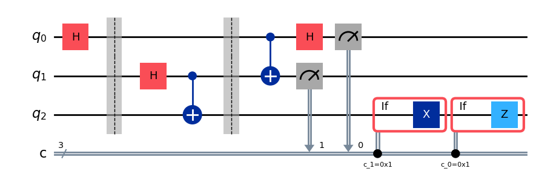
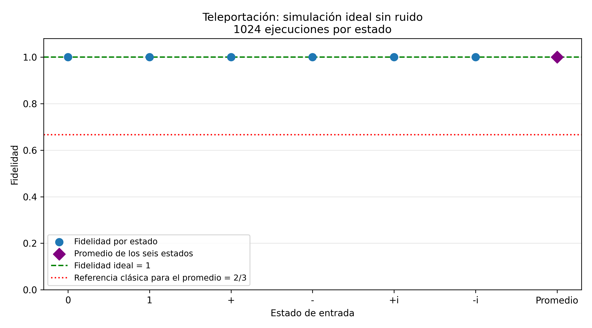
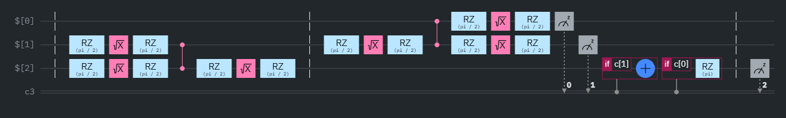
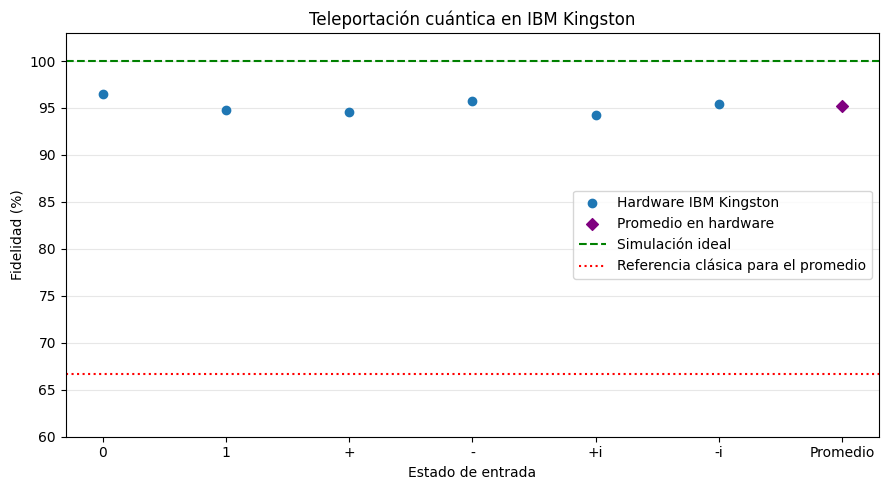
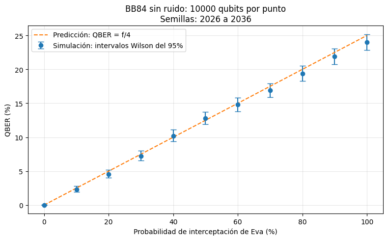
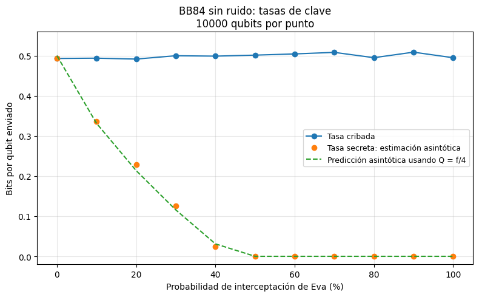

# Teleportación Cuántica y Criptografía Cuántica BB84

<p align="center">
  <strong>Proyecto de Mecánica Cuántica</strong><br>
  Ingeniería Física · Facultad de Ingeniería<br>
  Universidad Autónoma de Chihuahua
</p>

<p align="center">
  
  
  
  
</p>

---

## Descripción

Este proyecto aborda el estudio teórico y computacional de dos aplicaciones fundamentales de la mecánica cuántica: la **teleportación cuántica** y la **criptografía cuántica mediante el protocolo BB84**.

Se desarrollan simulaciones numéricas, circuitos cuánticos y análisis de resultados para estudiar los fundamentos físicos y matemáticos de ambos protocolos.

El trabajo incluye la implementación de la teleportación cuántica para seis estados, su evaluación en hardware cuántico de IBM y el análisis del protocolo BB84 bajo diferentes escenarios de interceptación de información.

## Contenido

- [Teleportación cuántica](#1-teleportación-cuántica)
- [Criptografía cuántica BB84](#2-criptografía-cuántica-bb84)
- [Resultados](#3-resultados)
- [Estructura del repositorio](#4-estructura-del-repositorio)
- [Tecnologías utilizadas](#5-tecnologías-utilizadas)
- [Instalación y ejecución](#6-instalación-y-ejecución)
- [Referencias](#7-referencias)

---

## 1. Teleportación cuántica

Se estudia e implementa el protocolo de teleportación cuántica mediante circuitos de tres qubits, utilizando el entrelazamiento cuántico y la comunicación clásica para transferir un estado cuántico desconocido.

Se realizan simulaciones para seis estados cuánticos, evaluando las fidelidades obtenidas y comparando los resultados con las predicciones teóricas.

### Implementación en simulador

[Ver notebook: Teleportación de seis estados](Implementacion_Circuito_Cuantico/Teleportacion_seis_estados_resultados_y_grafica/Teleportacion_seis_estados_resultados_y_grafica_ipynb.ipynb)

**Circuito cuántico lógico:**

<p align="center">
  
</p>

**Resultados de fidelidad:**

<p align="center">
  
</p>

### Implementación en hardware cuántico de IBM

Se realiza una implementación del protocolo en hardware cuántico real mediante IBM Quantum, considerando la transpilación del circuito y las características del dispositivo utilizado.

[Ver notebook: Teleportación en IBM Quantum](Implementacion_Circuito_Cuantico/Teleportacion_IBM_Kingston/Teleportacion_hardware_IBM.ipynb)

**Circuito transpilado:**

<p align="center">
  
</p>

**Comparación de resultados:**

<p align="center">
  
</p>

---

## 2. Criptografía cuántica BB84

Se implementa el protocolo BB84, propuesto por Charles Bennett y Gilles Brassard en 1984, para estudiar la distribución segura de claves mediante principios de mecánica cuántica.

El protocolo utiliza dos bases de medición:

- **Base Z:** base computacional.
- **Base X:** base diagonal.

Se analizan tres escenarios:

### BB84 sin espía

Simulación de la comunicación entre Alice y Bob sin intervención de terceros. Se generan bits y bases aleatorias, se comparan las bases utilizadas y se obtiene la clave cribada.

[Ver notebook: BB84 sin espía](Implementacion_Circuito_Cuantico/BB84_sin_espia.ipynb)

### BB84 con espía

Se incorpora a Eva como una tercera participante que intercepta y mide los estados cuánticos antes de que lleguen a Bob. Se estudia cómo esta intervención introduce errores en la clave compartida.

[Ver notebook: BB84 con espía](Implementacion_Circuito_Cuantico/BB84_con_espia.ipynb)

### BB84 con interceptación parcial

Se analiza el efecto de diferentes porcentajes de interceptación sobre la comunicación, estudiando la relación entre la fracción de qubits interceptados y la tasa de error cuántico de bits (QBER).

[Ver notebook: Interceptación parcial](Implementacion_Circuito_Cuantico/BB84_interceptacion_parcial.ipynb)

---

## 3. Resultados

Se realiza un análisis de los resultados obtenidos mediante simulaciones numéricas, comparando los valores experimentales con las predicciones teóricas.

### Análisis de QBER

La tasa de error cuántico de bits (QBER) permite evaluar la presencia de perturbaciones en el proceso de distribución de claves.

<p align="center">
  
</p>

### Tasas de generación de claves

<p align="center">
  
</p>

### Archivos de resultados

- [Datos de simulación BB84 (CSV)](Implementacion_Circuito_Cuantico/BB84_resultados_y_graficas/resultados_bb84.csv)
- [Análisis de QBER y tasas de clave](Implementacion_Circuito_Cuantico/BB84_resultados_y_graficas/BB84_QBER_y_tasas_de_clave.ipynb)
- [Fidelidades de teleportación (CSV)](Implementacion_Circuito_Cuantico/Teleportacion_seis_estados_resultados_y_grafica/teleportacion_fidelidades_simuladas.csv)
- [Resultados de hardware IBM (JSON)](Implementacion_Circuito_Cuantico/Teleportacion_IBM_Kingston/teleportacion_resultados_hardware.json)

---

## 4. Estructura del repositorio

```text
teleportacion-criptografia-cuantica/
│
├── README.md
│
├── Reporte Teleportación cuántica y
│   criptografía cuántica.pdf
│
├── Implementacion_Circuito_Cuantico/
│   │
│   ├── BB84_sin_espia.ipynb
│   ├── BB84_con_espia.ipynb
│   ├── BB84_interceptacion_parcial.ipynb
│   ├── REFERENCIAS.md
│   │
│   ├── BB84_resultados_y_graficas/
│   │   ├── BB84_QBER_y_tasas_de_clave.ipynb
│   │   ├── BB84_QBER_con_incertidumbre.png
│   │   ├── BB84_tasas_de_clave.png
│   │   └── resultados_bb84.csv
│   │
│   ├── Teleportacion_seis_estados_resultados_y_grafica/
│   │   ├── Teleportacion_seis_estados_resultados_y_grafica_ipynb.ipynb
│   │   ├── teleportacion_circuito_logico.png
│   │   ├── teleportacion_conteos_simulados.json
│   │   ├── teleportacion_fidelidades_simuladas.csv
│   │   └── teleportacion_fidelidades_simuladas.png
│   │
│   └── Teleportacion_IBM_Kingston/
│       ├── Teleportacion_hardware_IBM.ipynb
│       ├── teleportacion_circuito_transpilado_IBM_Kingston.png
│       ├── teleportacion_comparacion_hardware.png
│       └── teleportacion_resultados_hardware.json
│
├── notas/
│   ├── Notas_del_codigo.pdf
│   ├── Quantum Computation - Bez.pdf
│   ├── Quantum Computing - Rieffel .pdf
│   ├── Quantum Mechanics - Zubairy.pdf
│   └── contexto_historico.pdf
│
└── referencias/
    ├── Quantum Computation - Bez.pdf
    ├── Quantum Computing - Rieffel.pdf
    └── Quantum Mechanics - Zubairy.pdf
```

---

## 5. Tecnologías utilizadas

| Herramienta | Aplicación |
|---|---|
| Python | Programación y simulación numérica |
| NumPy | Operaciones y generación de datos |
| Matplotlib | Visualización y gráficas |
| Qiskit | Construcción de circuitos cuánticos |
| IBM Quantum | Ejecución en hardware cuántico |
| Jupyter Notebook | Desarrollo de simulaciones |
| Google Colab | Ejecución de notebooks |

---

## 6. Instalación y ejecución

Clonar el repositorio:

```bash
git clone <URL_DEL_REPOSITORIO>
```

Instalar las dependencias principales:

```bash
pip install numpy matplotlib qiskit pylatexenc
```

Abrir los archivos `.ipynb` utilizando Jupyter Notebook o Google Colab.

Para la ejecución en hardware cuántico de IBM es necesario contar con acceso a IBM Quantum y configurar las credenciales correspondientes.

---

## 7. Referencias

Las fuentes bibliográficas utilizadas se encuentran en las carpetas:

- `notas/`
- `referencias/`
- `Implementacion_Circuito_Cuantico/REFERENCIAS.md`

El desarrollo teórico completo puede consultarse en el documento:

[Reporte: Teleportación cuántica y criptografía cuántica](Reporte%20Teleportaci%C3%B3n%20cu%C3%A1ntica%20y%20criptograf%C3%ADa%20cu%C3%A1ntica.pdf)

---

<p align="center">
  <strong>Facultad de Ingeniería</strong><br>
  Universidad Autónoma de Chihuahua<br>
  Ingeniería Física<br>
  Proyecto de Mecánica Cuántica
</p>
